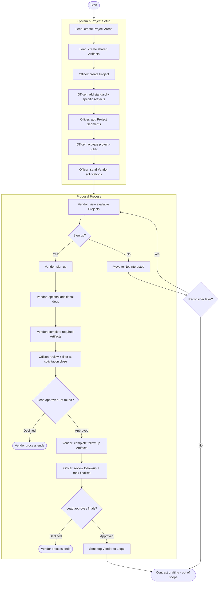

# Portfolio Demo - Vendor Proposal Management
This app manages all stages of vendor proposal management for projects.

**Procurement Officers** generate many projects to which **Vendors** can submit propsals. **Procurement Officers** specify documentation or other artifacts to provide along with the **Vendor's** proposal. These artifacts are specific to each project.

**Vendors** submit proposals to many projects. They satisfy artifacts requested by the **Procurement Officer**.

## The Production Application
For descriptive purposes only. This README outlines the workflow and technology used for the Production application. The demo application will use other libraries and a simplified, client only UI.

# Technology
## Frontend Technology
The Frontend is built with React and TypeScript. Routing and API requests use the Tanstack libraries. The GraphQL hooks are generated using the React Native Codegen library. The UI design uses Material UI components. 

The UI follows a Container-Presentational pattern. The logical and presentational split improves the reusability of shared components.

SurveyJS is used to standardize the construction and display of form based artifacts. SurveyJS allows **Procurement Officers** to compose form based artifacts without the need for technical staff.

### Frontend Tech List
- Vite
- React
- TypeScript
- Tanstack Router
- Tanstack Query
- React Native Codegen
- Material UI components
- SurveyJS

## Backend Technology
The backend is built using .NET in C#. The app and infrastructure uses Aspire for orchestration. The primary API is GraphQL using Chillicream's Hot Chocolate framework. Data is stored using a SQL database with schema generated with Entity Framework's code first migrations. SurveyJS schemas are stored in CosmosDb document database. Files are stored in Azure Blob Storage.

### Backend Tech List
- .NET 10
- Aspire
- ASP.NET
- Hot Chocolate GraphQL Server
- Entity Framework
- SQL
- Azure CosmosDb
- Azure Blob Storage

# Roles
The application is split into three primary roles; **Procurement Leads**, **Procurement Officers**, and **Vendors**. Procurement roles create and manage projects. **Vendors** submit proposals in order to secure projects.

## Procurement Lead
**Procurement Leads** manage the shared resources for all **Procurement Officers** in the platform. Some project proposal artifacts are standardized across all projects. Artifacts related to company contacts, equal opportunity, environmental impact, liability insurance, and other areas are maintained at an organization level. Project areas are created by the **Procurement Leads** to organize related artifacts by the organization department. Project areas might be Facilities Maintenance, Cafeteria, Entertainment, Staffing, etc. **Procurement Leads** are also the final approvers for any **Vendor** proposal before sending the information off to the legal department for drafting contracts.

## Procurement Officer
**Procurement Officers** are responsible for creating projects that solicit **Vendor** proposals. They set the correct Project Area and ensure standardized artifacts are added to each project. They create any additional artifacts that might be specific to the project. For example, a plumbing services contract may be for a specific building and outline that scope. The **Procurement Officer** sets dates for projects to go live and open up for **Vendors** to begin submitting their proposals. 

## Vendor
**Vendors** view a list of available Projects and select those that they actively pursue. **Vendors** sign up for a project to indicate to a **Procurement Officer** that they will submit proposals. **Vendors** review required artifacts and provide information to satisfy those requirements. **Vendors** will also provide information outside required artifacts that they feel will help in the selection process. This additional information might be customer referrals, training documents, certifications, or links to previously secured projects.

# Access and Security
**Procurement Leads** and **Procurement Officers** have access to all data for Projects and proposals. They are the owners of the platform and its content. 

**Procurement Leads** have access to modify the shared artifacts and other data on the platform. They are also responsible for approving Proposals. They will also have the same role as a **Procurement Officer**.

**Procurement Officers** have access to create and modify Projects in the platform. They can create, add, and remove Project specific artifacts. They have access to view all vendors and solicit any to sign up for a Project.

Each **Vendor** is its own business. It will only have access to its own data submitted to projects. A **Vendor** cannot view projects that are not publicly available. They cannot modify project data. They cannot view artifacts or other info from other **Vendors**.

# Workflow
## Overview
The diagram below shows the end-to-end process across all three roles, from system
and project setup through the vendor proposal lifecycle to legal handoff. See the
[Workflows design doc](design-docs/03-workflows.md) for the detailed per-role flows
and the proposal state machine.

## System Setup - Procurement Lead
1. Create Project Areas (Ex. Facilities Maintenance)
2. Creates shared artifacts (Ex. Contact Form)

## Project Setup - Procurement Officer
1. Create a new Project
    - Project Area
    - Descriptive Name
    - Project outline
    - Project Scope
    - Open and close dates (When vendors can sign up)
    - Assign Procurement Lead
2. Add Project Artifacts
    - Add standard Artifacts (Ex. Liability Insurance Info)
    - Add project specific Artifacts
3. Add project segments 
    - Proposal solicitation
    - Vendor artifact submissions
    - Proposal filtering
    - Follow-up artifact submissions
    - Final Proposal selection
4. Activate project for public viewing
5. Send Vendor solicitations
    - Vendors may be specifically notified to sign up for the project proposal process

## Proposal Process
### Vendor
1. View available Projects
    - Some projects may be active but not yet open for signup
2. Select a Project and Sign up
3. (Optional) Submit additional documentation (Ex. customer referrals)
4. Complete required Project Artifacts
5. Procurement Officer Filtering
    - Vendor Proposal may be declined.
    - Declined Proposals end the Vendor process for the Project.
6. Complete follow-up Proposal Artifacts
7. Final Proposal Selection
    - Vendor Proposal may be declined
    - Declined Proposals end the Vendor process for the Project.
8. Proposal selected
    - Process moves to legal for contract creation and signing.

### Procurement Officer
1. Review Vendor list at end of Solicitation period.
2. Review Vendor Artifacts during Proposal Filtering
3. Filter Vendor proposals
    - Decline Vendors who do not meet Project needs
4. Send follow-up artifacts for Vendors to continue
5. Review follow-up artifacts
6. Finalize Vendors
    - Rank successful proposals
    - Send top Vendor on to legal for contracts
    - Prepare backup Vendors in event that top Vendor falls through.

### Procurement Lead
1. Approve Filtered Vendors from 1st round
2. Review finalized vendor list
3. Approve final vendors and send to legal
