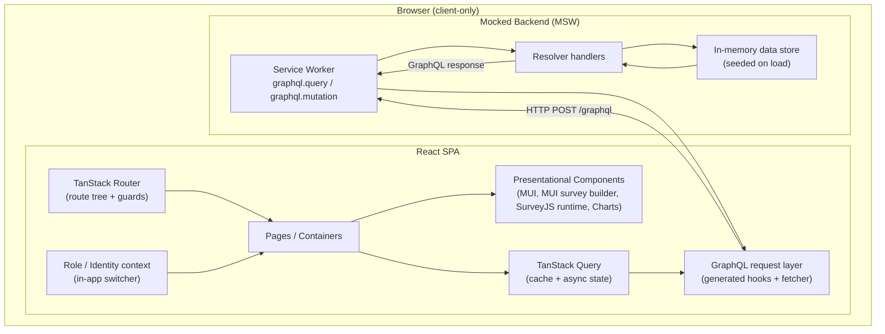
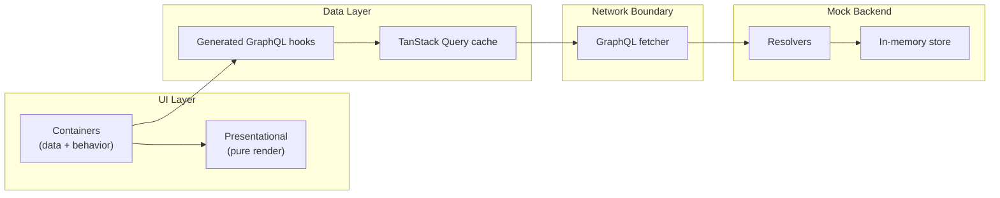
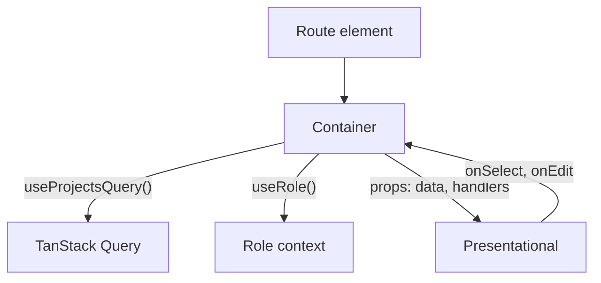
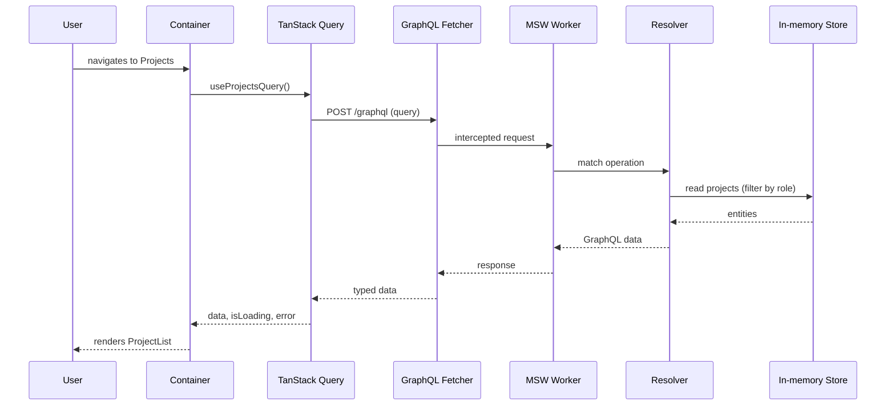
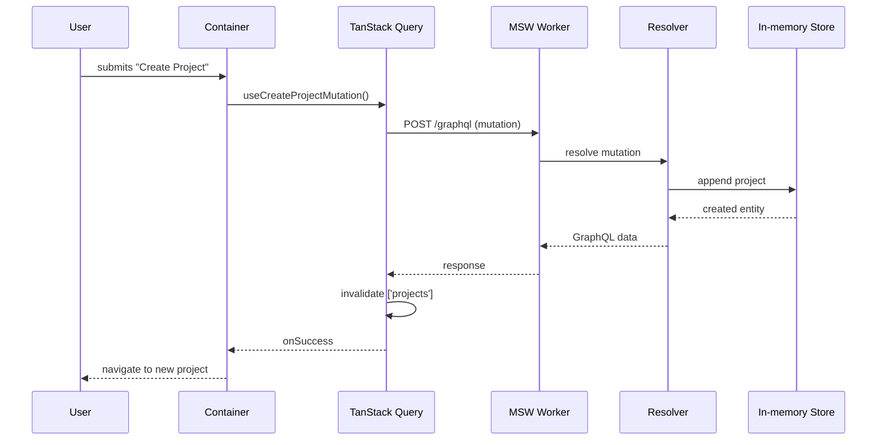
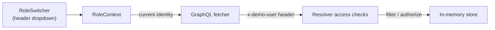

# 01 — Architecture

This document describes the technical architecture of the demo: the high-level
system view, the module/folder layout, the container–presentational pattern, and
how data flows from the UI through TanStack Query to the mocked GraphQL backend.

See the [Overview](./00-overview.md) for scope and key decisions.

## 1. High-level system view

The demo is a single-page application. Everything runs in the browser. The
"backend" is a Mock Service Worker (MSW) worker that intercepts GraphQL requests
and resolves them against an in-memory data store. No network calls leave the
browser.



**Why MSW + GraphQL?** The production system uses Hot Chocolate (GraphQL). By
mocking at the GraphQL network boundary, the React app, TanStack Query, and the
generated hooks are written exactly as they would be against a real server. When
a backend becomes available, MSW is removed and the GraphQL endpoint URL is
pointed at the real server — the UI does not change. See [Mock API](./05-mock-api.md).

## 2. Layered responsibilities



| Layer | Responsibility | Key tech |
|---|---|---|
| Presentational | Pure rendering, no data fetching; props in, events out | MUI, MUI survey builder, SurveyJS runtime, MUI X Charts |
| Container | Compose hooks, derive view models, handle events, pass props down | React, generated hooks |
| Data | Cache, loading/error state, invalidation | TanStack Query |
| Network | Serialize GraphQL operations, attach simulated identity | Generated fetcher |
| Mock backend | Resolve operations, enforce simulated role access, mutate store | MSW, resolvers |
| Store | Hold seeded entities in memory | Plain TS module |

## 3. Container–Presentational pattern

Each feature screen is split so that presentational components are reusable and
testable in isolation.

- **Container** (e.g., `ProjectListContainer`): calls generated query/mutation
  hooks, reads the current role from context, derives a view model, and renders a
  presentational component. Contains no JSX layout beyond composition.
- **Presentational** (e.g., `ProjectList`): receives data and callbacks as props,
  renders MUI components, emits events. No knowledge of GraphQL or the store.



## 4. Proposed folder structure

```text
src/
├── main.tsx                     # App bootstrap: MSW init, providers, router
├── app/
│   ├── router.tsx               # TanStack Router route tree
│   ├── providers.tsx            # Query, Theme, Role providers
│   └── theme.ts                 # MUI theme (color palette)
├── roles/
│   ├── RoleContext.tsx          # Current identity + switcher state
│   └── RoleSwitcher.tsx         # Header dropdown to change identity
├── graphql/
│   ├── schema.graphql           # Schema used by codegen + MSW
│   ├── operations/*.graphql     # Queries & mutations
│   ├── generated/               # Codegen output (hooks + types)
│   └── fetcher.ts               # GraphQL request function
├── mocks/
│   ├── browser.ts               # MSW worker setup
│   ├── handlers.ts              # graphql.query/mutation handlers
│   ├── resolvers/               # One resolver module per domain
│   └── store/
│       ├── store.ts             # In-memory store + reset
│       └── seed.ts              # Seed data generators
├── features/
│   ├── dashboard/               # containers + presentational + charts
│   ├── projects/
│   ├── artifacts/
│   ├── survey-builder/          # MUI-based survey builder (authoring)
│   ├── survey-runtime/          # SurveyJS render/complete wrappers
│   ├── vendors/
│   ├── proposals/
│   └── about/
├── components/                  # Shared presentational (layout, header, footer)
├── lib/                         # utils, formatters, date helpers
└── types/                       # shared domain types (if not generated)
```

## 5. Data flow — read path



## 6. Data flow — write path (mutation + cache invalidation)



## 7. Role / identity simulation

There is no real auth. A **Role context** holds the currently selected identity
(a seeded user with one or more roles). The in-app **Role Switcher** (header
dropdown) changes it. The selected identity is attached to every GraphQL request
as a simulated header so resolvers can enforce the access rules from the README
and demo spec.



Access rules enforced in resolvers (see [README Access and Security](../README.md#access-and-security)):

- **Lead:** all data; may edit shared artifacts; final proposal approver; also has Officer rights.
- **Officer:** create/modify projects and project artifacts; view all vendors.
- **Vendor:** only its own submissions; only publicly available projects; read-only on project/artifact definitions.

## 8. Cross-cutting concerns

| Concern | Approach |
|---|---|
| Error handling | TanStack Query error boundaries per route; MUI snackbar for mutation errors. |
| Loading states | MUI skeletons in presentational components, driven by `isLoading`. |
| Theming | Single MUI theme built from the demo color palette (see [UI/UX](./04-ui-ux.md)). |
| Simulated latency | Small random delay in resolvers so loading states are visible. |
| Reset | A "reset demo data" action re-seeds the in-memory store. |
| Type safety | End-to-end types from GraphQL codegen; no hand-written response types. |
