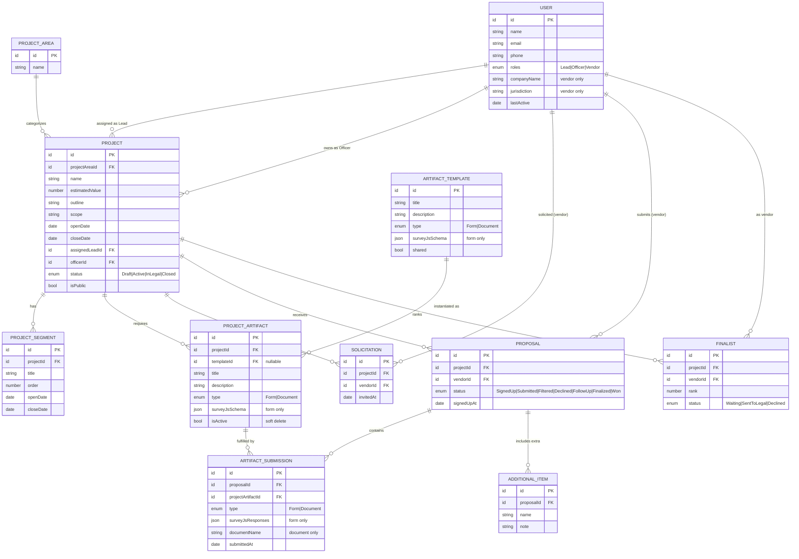
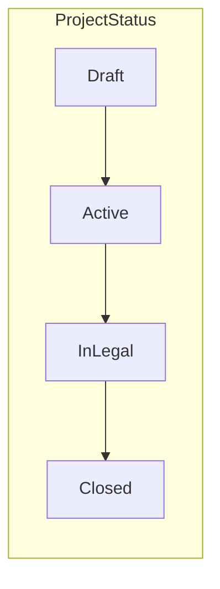
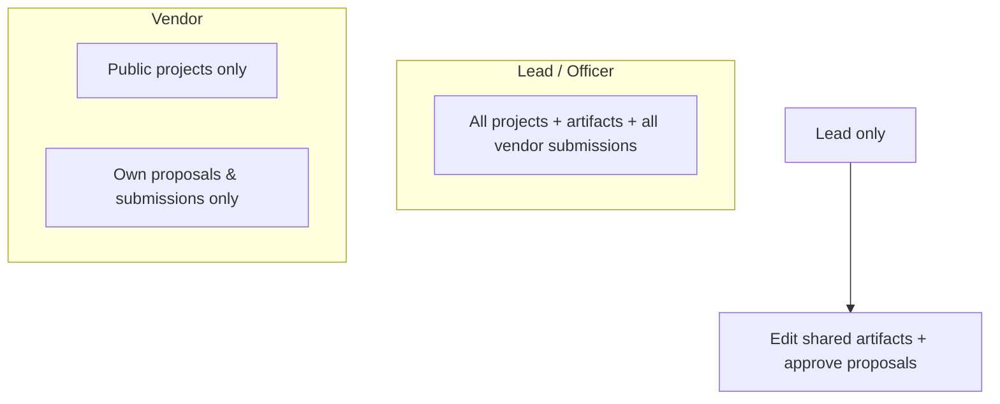

# 02 — Data Model

This document defines the demo's domain entities, their relationships, and
TypeScript-oriented type definitions. It is derived from the
[demo-design Data Structures](./demo-design.md#data-structures) section and the
[README roles/workflow](../README.md#workflow).

The same shapes drive the GraphQL schema (see [Mock API](./05-mock-api.md)) and
the in-memory seed data.

## 1. Entity-relationship diagram



## 2. Entity reference

### User
Represents any platform actor. A single user may hold both **Lead** and
**Officer** roles. **Vendor** users carry company-specific fields.

| Field | Type | Notes |
|---|---|---|
| id | ID | |
| name | string | |
| email, phone | string | contact info |
| roles | Role[] | subset of `Lead`, `Officer`, `Vendor` |
| companyName | string? | vendor only |
| jurisdiction | string? | vendor only (State/Country) |
| lastActive | ISO date | drives "last active" UI |

### Project Area
A department-level grouping (e.g., Facilities Maintenance, Cafeteria). Created by
**Procurement Leads**.

### Project
The central entity vendors respond to. Owned by an **Officer**, approved by an
assigned **Lead**. Edit-locked once `isPublic` is true (see demo spec Project Setup tab).

| Field | Type | Notes |
|---|---|---|
| estimatedValue | number | dollars; used in dashboard aggregates |
| openDate / closeDate | ISO date | vendor signup window |
| status | enum | `Draft` → `Active` → `InLegal` → `Closed` |
| isPublic | boolean | when true, setup fields lock |

### Project Segment
A time-boxed phase of a project (solicitation, submissions, filtering, follow-up,
final selection). Segments **may overlap** in dates. Ordered by `order`.

### Artifact Template vs. Project Artifact
- **Artifact Template** — a reusable/shared artifact maintained at the
  organization level by **Leads** (e.g., Contact Form, Liability Insurance). May
  be a Form (SurveyJS schema) or Document.
- **Project Artifact** — an artifact attached to a specific project. May be
  instantiated from a template or created ad hoc by an **Officer**. Soft-deleted
  (`isActive = false`) rather than removed, shown struck-through in the UI.

> **Form schema scope:** `surveyJsSchema` is a **SurveyJS-compatible** JSON schema,
> but the demo authors it with a custom **MUI survey builder** (not the SurveyJS
> Creator) and supports only four question types: `text`, `radiogroup`,
> `checkbox`, and `dropdown`. Each question carries `name`, `title`, `type`,
> `isRequired`, and (for choice types) a `choices` list. The SurveyJS runtime
> renders this schema for preview and completion. See
> [UI/UX §6](./04-ui-ux.md#6-form-artifacts--survey-builder--runtime).

### Solicitation
Records that an **Officer** invited a specific **Vendor** to a project.

### Proposal
A vendor's participation in a project. Its `status` is the proposal state machine
(see [Workflows](./03-workflows.md)).

### Artifact Submission
A vendor's response to a single project artifact — SurveyJS responses (Form) or a
document name (Document).

### Additional Item
Optional extra material a vendor attaches to strengthen a proposal (referrals,
certifications, links).

### Finalist
A ranked vendor selected for potential win, tracked through legal handoff.

## 3. Status enumerations



| Enum | Values |
|---|---|
| Role | `Lead`, `Officer`, `Vendor` |
| ProjectStatus | `Draft`, `Active`, `InLegal`, `Closed` |
| ArtifactType | `Form`, `Document` |
| ProposalStatus | `SignedUp`, `Submitted`, `Filtered`, `Declined`, `FollowUp`, `Finalized`, `Won` |
| FinalistStatus | `Waiting`, `SentToLegal`, `Declined` |

## 4. TypeScript type sketch

These informal shapes guide the GraphQL schema and seed generators. Final types
are produced by GraphQL codegen.

```ts
type ID = string;

type Role = 'Lead' | 'Officer' | 'Vendor';

interface User {
  id: ID;
  name: string;
  email: string;
  phone: string;
  roles: Role[];
  companyName?: string;   // vendor
  jurisdiction?: string;  // vendor
  lastActive: string;     // ISO
}

interface Project {
  id: ID;
  projectAreaId: ID;
  name: string;
  estimatedValue: number;
  outline: string;
  scope: string;
  openDate: string;
  closeDate: string;
  assignedLeadId: ID;
  officerId: ID;
  status: 'Draft' | 'Active' | 'InLegal' | 'Closed';
  isPublic: boolean;
  segments: ProjectSegment[];
  artifacts: ProjectArtifact[];
}

interface ProjectSegment {
  id: ID; projectId: ID; title: string; order: number;
  openDate: string; closeDate: string;
}

interface ProjectArtifact {
  id: ID; projectId: ID; templateId?: ID;
  title: string; description: string;
  type: 'Form' | 'Document';
  surveyJsSchema?: unknown; // Form
  isActive: boolean;        // soft delete
}

interface Proposal {
  id: ID; projectId: ID; vendorId: ID;
  status: 'SignedUp' | 'Submitted' | 'Filtered' | 'Declined'
        | 'FollowUp' | 'Finalized' | 'Won';
  signedUpAt: string;
  submissions: ArtifactSubmission[];
  additionalItems: AdditionalItem[];
}

interface ArtifactSubmission {
  id: ID; proposalId: ID; projectArtifactId: ID;
  type: 'Form' | 'Document';
  surveyJsResponses?: Record<string, unknown>; // Form
  documentName?: string;                        // Document
  submittedAt: string;
}
```

## 5. Derived / computed values

The dashboards (see [UI/UX](./04-ui-ux.md)) rely on aggregates computed in
resolvers or client selectors rather than stored:

| Metric | Derivation |
|---|---|
| Active Projects count | projects where `status = Active` |
| Active Projects total estimated value | sum `estimatedValue` of active projects |
| Active Vendor count | distinct vendors with a non-declined proposal |
| Projects in legal | projects where `status = InLegal` |
| % Projects by active segment | group active projects by their current segment |
| Top vendors by estimated total | sum estimated value of won/finalist projects per vendor |
| Estimated value closing (6 months) | sum `estimatedValue` by `closeDate` month |

## 6. Access model (data visibility)

Enforced in resolvers from the simulated identity (see [Architecture §7](./01-architecture.md)):


