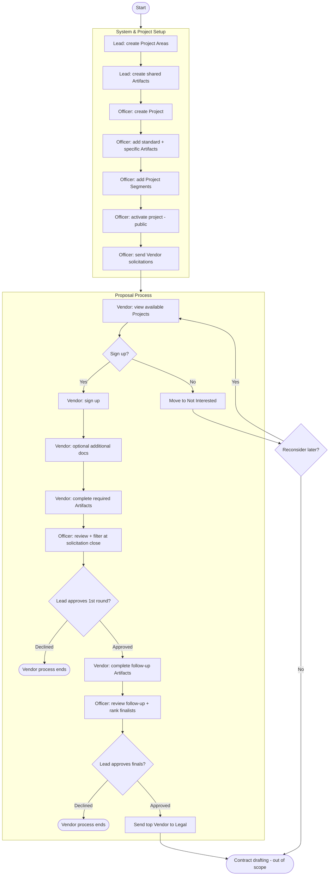
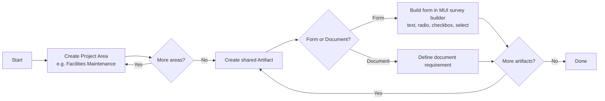
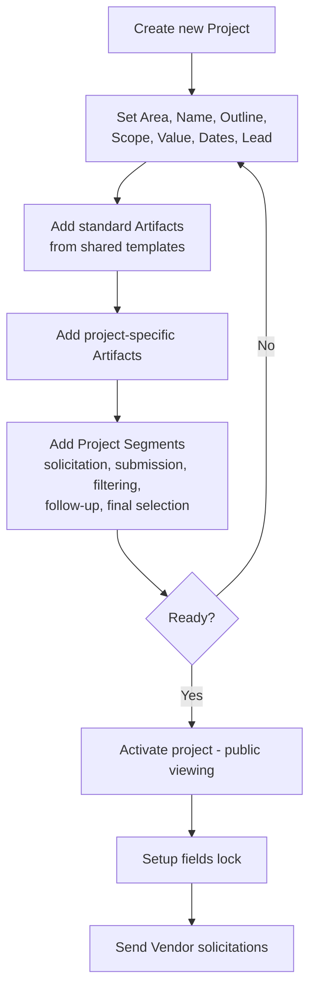
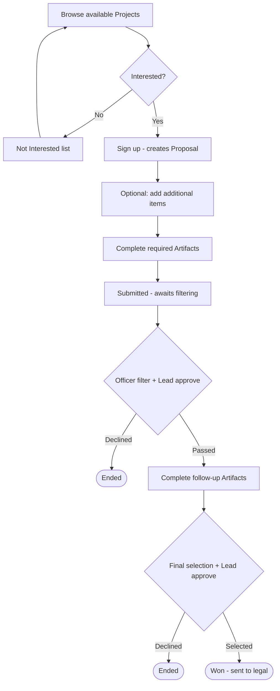
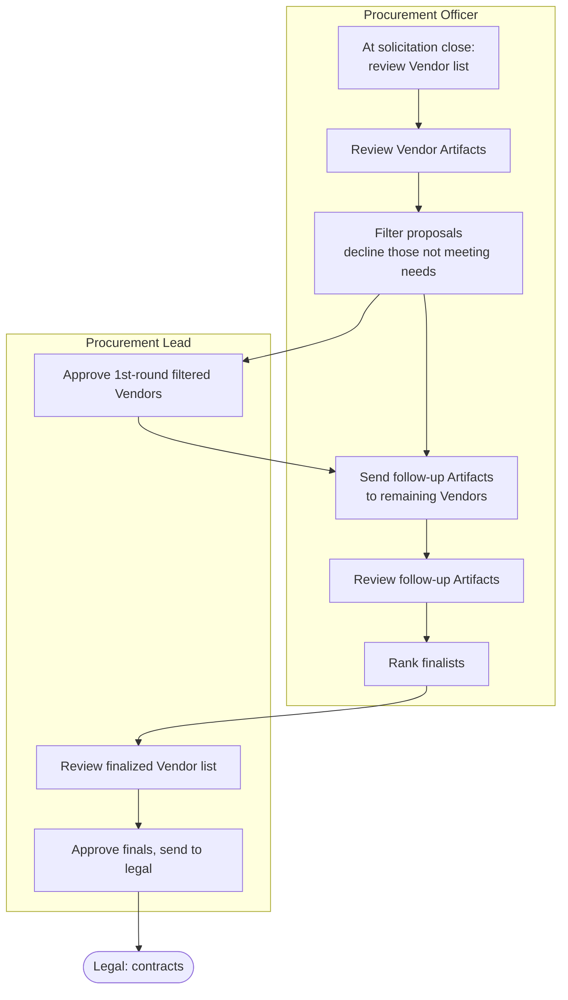
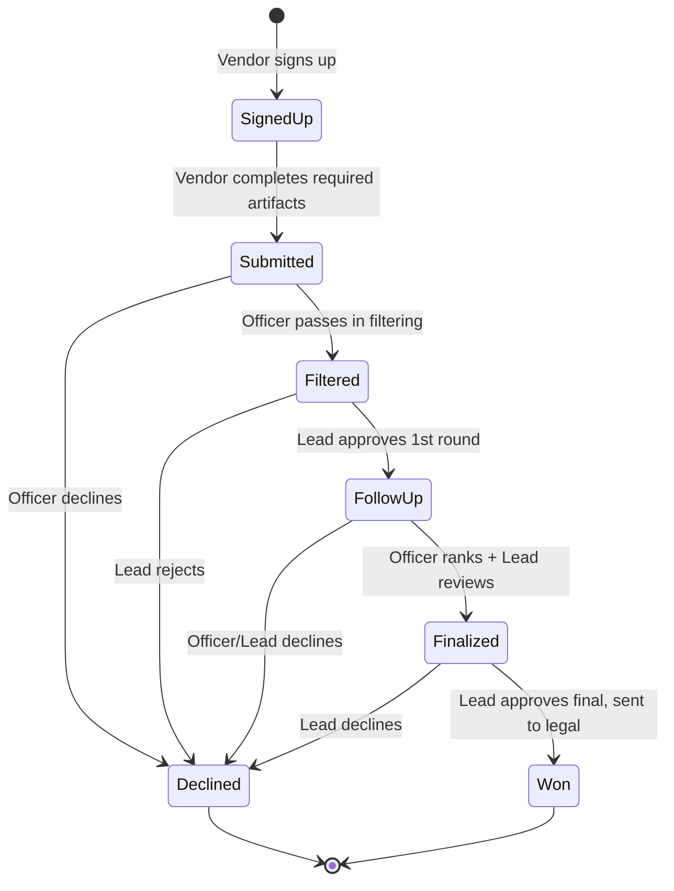
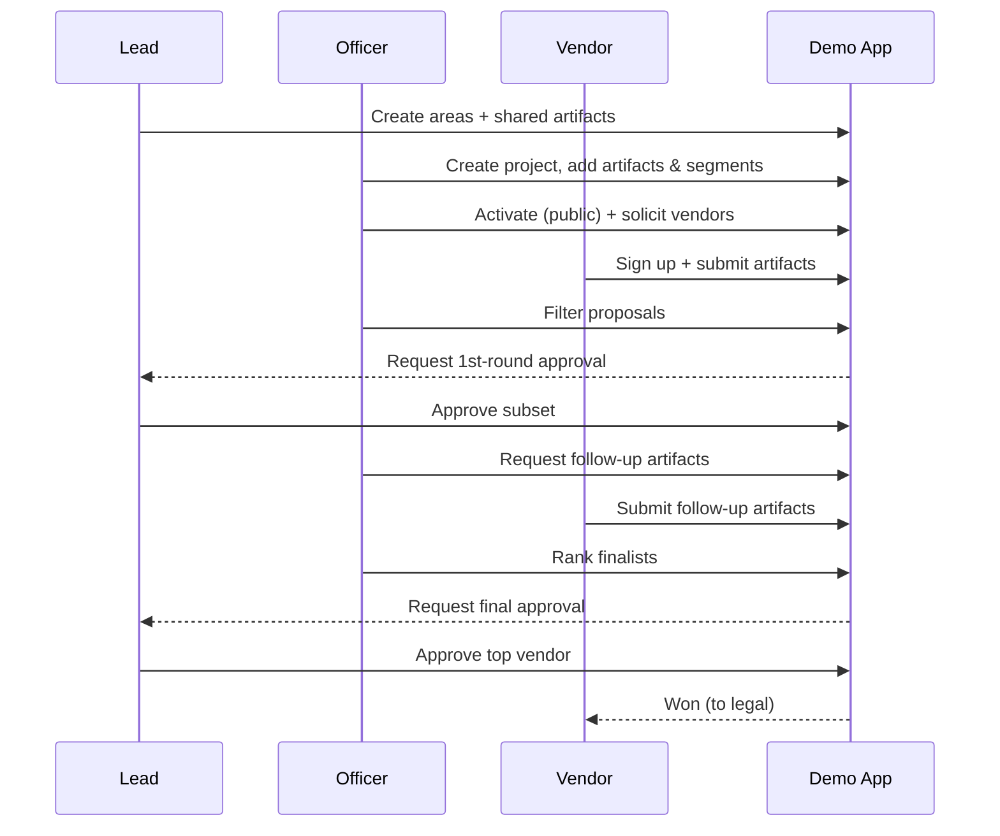
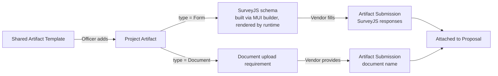

# 03 — Workflows

This document captures the business process flows the demo simulates, expressed
as mermaid diagrams. It fills in the `TODO: Process flowchart` placeholder in the
[README Workflow](../README.md#workflow) section and the demo's
[workflow reference](./demo-design.md#workflow).

Actors: **Procurement Lead**, **Procurement Officer**, **Vendor**. See
[Data Model](./02-data-model.md) for the entities referenced here.

## 1. End-to-end process overview

## 2. System setup — Procurement Lead

## 3. Project setup — Procurement Officer

> **Edit lock:** Once a project is public (`isPublic = true`), setup fields are
> read-only in the UI (demo spec, Project Setup tab). Artifacts can still be added;
> removals are soft deletes.

## 4. Proposal lifecycle — Vendor perspective

## 5. Review & selection — Procurement Officer and Lead

## 6. Proposal state machine

This is the authoritative state model for `Proposal.status`
(see [Data Model §3](./02-data-model.md)). The demo's resolvers and UI actions
only permit the transitions shown.

| Transition | Trigger | Actor | Guard |
|---|---|---|---|
| → SignedUp | Sign up | Vendor | project is public & within open window |
| SignedUp → Submitted | Submit proposal | Vendor | all active required artifacts submitted |
| Submitted → Filtered | Pass filter | Officer | — |
| Submitted → Declined | Decline | Officer | — |
| Filtered → FollowUp | Approve round 1 | Lead | — |
| Filtered → Declined | Reject round 1 | Lead | — |
| FollowUp → Finalized | Rank finalist | Officer | follow-up artifacts reviewed |
| Finalized → Won | Approve final | Lead | ranked top / selected |
| any (pre-Won) → Declined | Decline | Officer/Lead | ends vendor process |

## 7. Role interaction sequence (happy path)

## 8. Artifact fulfillment flow

How a required project artifact becomes a vendor submission:

> **Shared artifact pre-fill:** From the Vendor *Shared Artifacts* page, a vendor
> can complete shared artifacts once; these responses apply to any project they
> later sign up for (demo spec). In the demo this copies responses into the new
> proposal's submissions.
