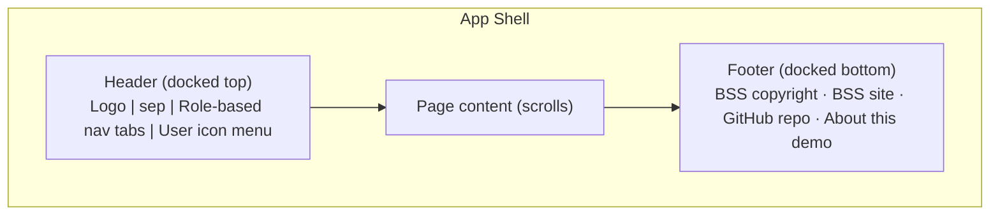
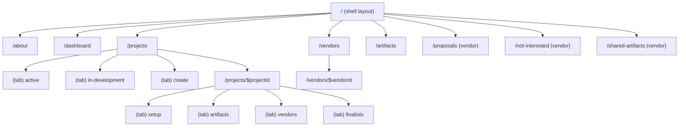
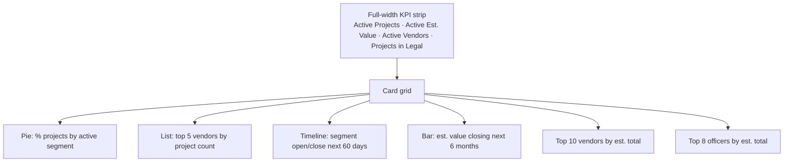
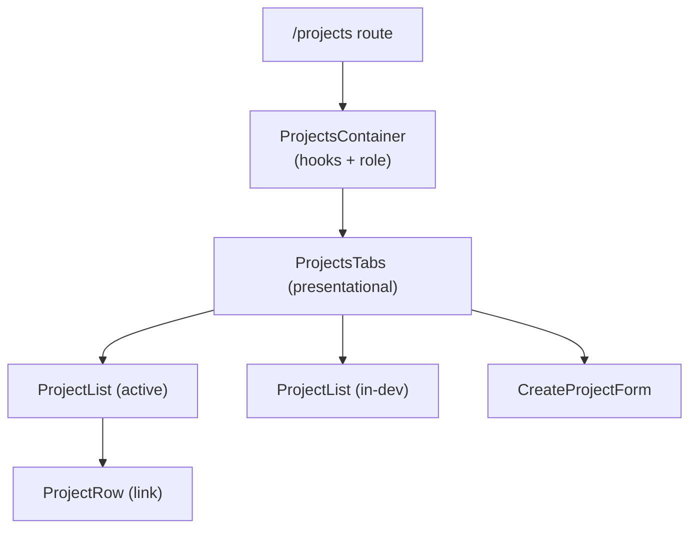
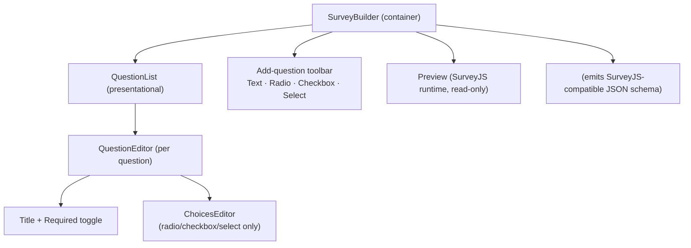

# 04 — UI / UX

This document specifies the demo's navigation, routes, page layouts, component
structure, and theming. It expands the [demo-design UI](./demo-design.md#ui)
section into an implementable spec.

See [Architecture](./01-architecture.md) for the container–presentational split
and [Data Model](./02-data-model.md) for the data each page consumes.

## 1. Global layout

- **Header:** left-aligned logo, separator, role-dependent navigation tabs, and a
  right-aligned user icon with a dropdown. The dropdown contains the **Role
  Switcher** (choose identity) and a link to *About this demo*.
- **Content:** the routed page; vertical scroll only.
- **Footer:** centered links — BSS copyright, BSS site, GitHub repo, About.

## 2. Navigation by role

The visible tabs depend on the active identity (from the Role context).

| Role | Tabs |
|---|---|
| Lead / Officer | Dashboard · Projects · Vendors · Artifacts |
| Vendor | Dashboard · Projects · Proposals · Not Interested · Shared Artifacts |

> **Lead vs Officer:** both see the same procurement tabs. Lead-only capabilities
> (edit shared artifacts, approve proposals) are enabled by role checks within
> pages, not by extra tabs.

## 3. Route map

TanStack Router nested routes; detail pages use tabbed child routes so the active
tab is reflected in the URL and is deep-linkable.

## 4. Page specifications

### 4.1 About this demo — `/about`
Describes the production system and how the demo differs (client-only, in-memory,
mocked backend). Links back to the demo landing/dashboard.

### 4.2 Procurement Dashboard — `/dashboard` (Lead/Officer)

Charts use MUI X Charts; data comes from derived aggregates (see
[Data Model §5](./02-data-model.md)).

### 4.3 Projects (procurement) — `/projects`
Four tabs:
1. **Active** — every project that is neither Draft nor Closed (e.g. Active and
   In legal); ordered by next segment end date; each row links to the project.
2. **In development** — Draft projects only; ordered by solicitation open date.
3. **Closed** — Closed projects only; ordered by solicitation open date.
4. **Create new project** — form (Area, Name, Value, Outline, Scope, Open/Close
   dates, assigned Lead).

### 4.4 Project detail (procurement) — `/projects/$projectId`
Four tabs:

| Tab | Contents |
|---|---|
| Setup | Vendor count + active segments at top; editable project fields; **locked once public**. |
| Artifacts | List of project artifacts; add anytime; removed artifacts show inactive/struck-through (soft delete); each artifact has a sub-row per vendor submission. |
| Vendors | All vendors with status (solicited / signed up / declined); sub-row per artifact submission; sub-row per additional uploaded item. |
| Finalists | Ranked list of selected vendors; status (sent to legal / waiting / declined). |

### 4.5 Vendors (procurement) — `/vendors`
List of all vendors: name, last active, estimated total projects won, currently
signed up count. Rows link to the vendor detail page.

### 4.6 Vendor detail (procurement) — `/vendors/$vendorId`
Vendor info; graphs of estimated totals, statuses, last active; list of all
projects the vendor signed up for.

### 4.7 Artifacts (procurement) — `/artifacts`
List of shared artifact templates addable to projects. Form artifacts open in a
modal (SurveyJS preview). **Leads** can add/edit/remove; **Officers** view only.

### 4.8 Vendor Dashboard — `/dashboard` (Vendor)
Same information shape as the procurement vendor-detail view, scoped to the signed
-in vendor. Vendor can edit demographic info.

### 4.9 Projects (vendor) — `/projects`
Projects the vendor has **not** signed up for. Solicited projects pinned to the
top; then ordered by solicitation closing date (descending). Row actions: sign up
or mark *Not Interested*.

### 4.10 Proposals (vendor) — `/proposals`
Projects the vendor signed up for; each links to the project detail (vendor view).

### 4.11 Project detail (vendor) — `/projects/$projectId`
Same structure as the procurement project view, but the vendor can **complete
artifacts** (SurveyJS forms / document entries) and add additional items.

### 4.12 Not Interested (vendor) — `/not-interested`
Projects the vendor reviewed and skipped; hidden from Projects/Proposals. Vendor
may reconsider and sign up.

### 4.13 Shared Artifacts (vendor) — `/shared-artifacts`
Shared artifacts used across projects. Vendor can pre-complete them; responses
apply to any project they later sign up for.

## 5. Component structure (sample: Projects list)

Presentational components (`ProjectsTabs`, `ProjectList`, `ProjectRow`,
`CreateProjectForm`) take data + callbacks as props and are unit-testable without
the data layer.

## 6. Form artifacts — survey builder & runtime

Form artifacts use a **SurveyJS-compatible JSON schema** for storage and a
SurveyJS-compatible response shape, so the data remains portable to the
production system. However, the **SurveyJS Creator/Designer is not added to the
demo**. Instead, a lightweight **MUI-based survey builder** is implemented for
authoring, and the SurveyJS runtime renders the schema for preview and completion.

### 6.1 Supported question types

The demo builder supports only these four SurveyJS question types:

| Builder control | SurveyJS `type` | Notes |
|---|---|---|
| Text field | `text` | single-line text input |
| Radio group | `radiogroup` | single choice from `choices` |
| Checkbox group | `checkbox` | multiple choice from `choices` |
| Dropdown / select | `dropdown` | single choice from `choices` |

Each question stores: `name`, `title`, `type`, `isRequired`, and (for
radio/checkbox/select) a `choices` list. The builder emits a standard SurveyJS
schema object (`{ pages: [{ elements: [...] }] }` or a flat `{ elements: [...] }`)
so the SurveyJS runtime can render it unchanged.

### 6.2 Where each tool is used

| Context | Tool | Behavior |
|---|---|---|
| Artifact authoring (Lead) | **MUI survey builder** | Add/reorder/remove questions from the 4 supported types; edit title, required flag, and choices; output SurveyJS-compatible schema saved to the artifact template / project artifact. |
| Artifact preview (procurement) | **SurveyJS runtime** (`survey-react-ui`, read-only) | Render the saved schema in a modal. |
| Artifact completion (vendor) | **SurveyJS runtime** (`survey-react-ui`, edit) | Render the schema; responses saved to a submission. |

### 6.3 MUI survey builder layout

- **QuestionEditor** is a presentational component per question with title input,
  a required toggle, a type indicator, reorder (up/down) and delete controls.
- **ChoicesEditor** appears only for radio/checkbox/select; add/remove/edit
  choice values.
- A live **Preview** pane renders the current schema through the SurveyJS runtime
  so authors see exactly what vendors will complete.

> Decision note: the demo deliberately keeps SurveyJS-compatible schema and
> response formats (so production, which uses the full SurveyJS Creator, stays
> compatible) while replacing only the authoring surface with MUI controls limited
> to text, radio, checkbox, and select.

## 7. Theming & color palette

A single MUI theme is built from the demo palette.

| Token | Hex | Suggested usage |
|---|---|---|
| Primary | `#ff580f` | primary actions, active nav, key accents |
| Primary light | `#ff7e26` | hovers, secondary emphasis |
| Accent 1 | `#ff9c59` | chart series, highlights |
| Accent 2 | `#ffa472` | chart series, badges |
| Surface tint | `#ffc99d` | subtle backgrounds, table zebra, chips |

Guidelines:
- Use a neutral background with the palette reserved for emphasis and data viz.
- Ensure AA contrast for text on primary (`#ff580f` with white text passes for
  large/semibold; verify per component).
- Derive chart categorical scales from accents to keep dashboards on-brand.

## 8. Loading, empty, and error states

| State | Pattern |
|---|---|
| Loading | MUI `Skeleton` placeholders in lists/cards, driven by `isLoading`. |
| Empty | Friendly empty-state card with a primary call to action. |
| Error | Inline alert; mutation errors surface via a global snackbar. |
| Mutation pending | Disabled submit + spinner; optimistic UI optional. |

## 9. Responsive behavior

- Dashboard card grid: 3 columns (desktop) → 2 (tablet) → 1 (mobile).
- Header nav collapses into a menu on narrow widths.
- Detail tabs become scrollable on small screens.
