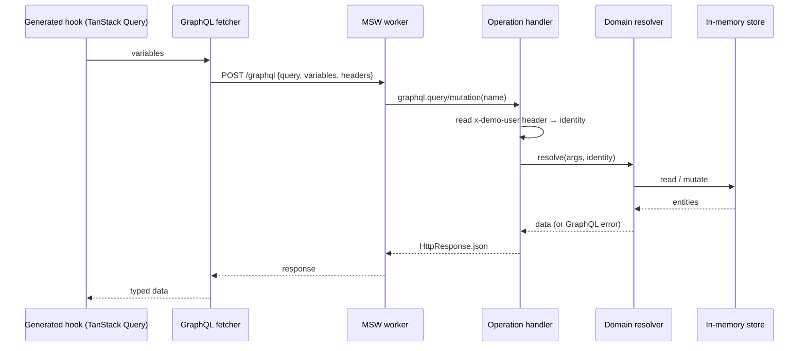
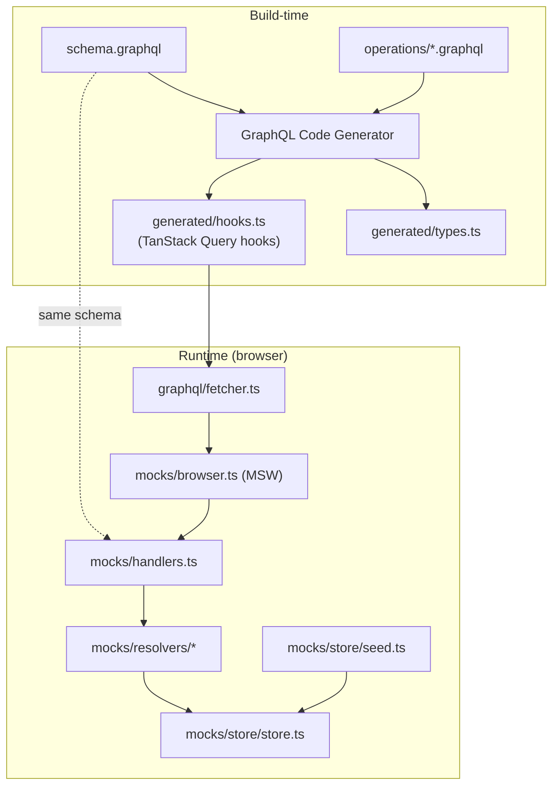
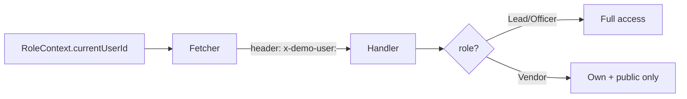
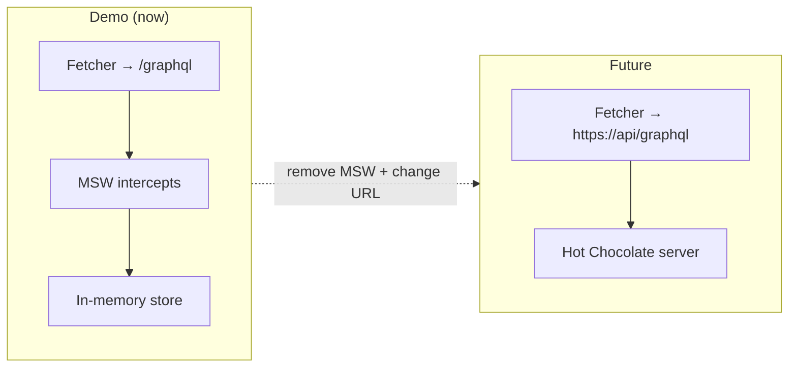

# 05 — Mock API & Data Layer

This document specifies the mocked backend: a **Mock Service Worker (MSW)** worker
that intercepts **GraphQL** operations and resolves them against an **in-memory
store**, plus the **GraphQL codegen** setup that produces typed hooks for the UI.

This mirrors the production Hot Chocolate GraphQL API so a real backend can be
swapped in with minimal UI changes. See [Architecture](./01-architecture.md).

## 1. Goals

- Present a GraphQL endpoint (`POST /graphql`) the app talks to exactly as it
  would a real server.
- Keep all data **in memory**; re-seed on every page load (no persistence).
- Enforce the demo's **role-based access** rules in resolvers.
- Produce **end-to-end types** via codegen so the UI has no hand-written response
  types.
- Be **removable**: deleting MSW and pointing the fetcher at a real URL should be
  the only change needed.

## 2. Request flow



## 3. Component responsibilities



## 4. GraphQL schema (shape)

The schema is the contract shared by codegen and the mock resolvers. Illustrative
excerpt (full enums in [Data Model §3](./02-data-model.md)):

```graphql
type Query {
  dashboard: DashboardMetrics!
  projects(filter: ProjectFilter): [Project!]!
  project(id: ID!): Project
  vendors: [User!]!
  vendor(id: ID!): User
  artifactTemplates: [ArtifactTemplate!]!
  myProposals: [Proposal!]!          # vendor-scoped
  availableProjects: [Project!]!     # vendor-scoped (public, not signed up)
}

type Mutation {
  createProject(input: CreateProjectInput!): Project!
  updateProject(id: ID!, input: UpdateProjectInput!): Project!
  activateProject(id: ID!): Project!
  addProjectArtifact(projectId: ID!, input: ArtifactInput!): ProjectArtifact!
  removeProjectArtifact(id: ID!): ProjectArtifact!   # soft delete
  solicitVendor(projectId: ID!, vendorId: ID!): Solicitation!

  signUp(projectId: ID!): Proposal!
  markNotInterested(projectId: ID!): Boolean!
  submitArtifact(input: SubmissionInput!): ArtifactSubmission!
  submitProposal(proposalId: ID!): Proposal!

  filterProposal(proposalId: ID!, pass: Boolean!): Proposal!   # Officer
  approveRound(proposalId: ID!, approve: Boolean!): Proposal!  # Lead
  rankFinalist(projectId: ID!, vendorId: ID!, rank: Int!): Finalist! # Officer
  approveFinal(proposalId: ID!, approve: Boolean!): Proposal!  # Lead
}
```

Query/mutation names drive the MSW handlers and the generated hook names
(`useProjectsQuery`, `useCreateProjectMutation`, …).

## 5. In-memory store

```ts
// mocks/store/store.ts
interface DemoStore {
  users: User[];
  projectAreas: ProjectArea[];
  projects: Project[];
  artifactTemplates: ArtifactTemplate[];
  solicitations: Solicitation[];
  proposals: Proposal[];
  finalists: Finalist[];
}

let store: DemoStore = seed();      // built on module load
export const getStore = () => store;
export const resetStore = () => { store = seed(); };
```

- Plain mutable arrays; resolvers read/write directly.
- `resetStore()` backs the UI "reset demo data" action.
- No persistence layer — refresh re-runs `seed()`.

## 6. Seed data

`seed.ts` generates a realistic dataset so dashboards and lists are populated
(see [Data Model §5](./02-data-model.md) for the metrics it must feed):

| Entity | Approx. volume | Notes |
|---|---|---|
| Users | ~3 leads/officers + ~12 vendors | varied roles, jurisdictions, last-active dates |
| Project areas | 5–6 | Facilities, Cafeteria, Staffing, Entertainment, … |
| Projects | ~15 | mix of Draft / Active / InLegal / Closed across areas |
| Segments | per project | overlapping dates spanning the next 60 days for the timeline |
| Artifact templates | 6–8 | mix of Form and Document; Form schemas are SurveyJS-compatible JSON limited to `text`, `radiogroup`, `checkbox`, `dropdown` |
| Proposals | ~30 | spread across all `ProposalStatus` values |
| Finalists | a few projects | ranked, mixed statuses |

Seed values are deterministic (fixed base date derived from "now") so charts look
consistent between loads.

## 7. Simulated identity & access control

The GraphQL fetcher attaches the current identity (from the Role context) as a
header; resolvers read it and apply access rules.



- **Vendor** queries (`myProposals`, `availableProjects`) and mutations are scoped
  to the identity; attempts to touch others' data return a GraphQL error.
- **Lead-only** mutations (`approveRound`, `approveFinal`, edit shared artifacts)
  reject non-Lead identities.

## 8. Simulated latency & errors

- Resolvers add a small randomized delay (e.g., 150–500 ms) so TanStack Query
  loading states are visible.
- An optional dev flag can make a chosen operation fail to exercise error UI.

## 9. Codegen configuration

- **Tool:** GraphQL Code Generator with the TanStack React Query plugin. (The
  README/demo wording "React Native Codegen" refers to GraphQL hook generation;
  for a React web + TanStack Query demo, the concrete tool is GraphQL Code
  Generator with `@graphql-codegen/typescript-react-query`.)
- **Inputs:** `schema.graphql` + `operations/*.graphql`.
- **Outputs:** typed operation variables, result types, and `useXQuery` /
  `useXMutation` hooks bound to the shared fetcher.
- **Script:** `npm run codegen` (and a `codegen:watch` variant).

> Decision note: if the project owner prefers to keep the exact "React Native
> Codegen" tool, that can be substituted — the architecture only requires that
> generated, typed GraphQL hooks sit on top of the shared fetcher.

## 10. Swapping in a real backend



Steps to switch:
1. Remove the MSW worker start in `main.tsx`.
2. Point the fetcher's endpoint at the real GraphQL URL.
3. Replace the simulated identity header with real auth tokens.

No changes to components, hooks, or TanStack Query usage.
