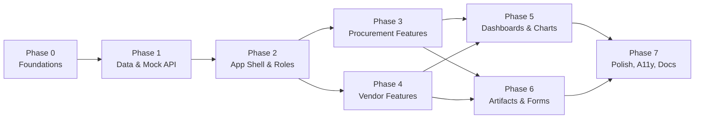
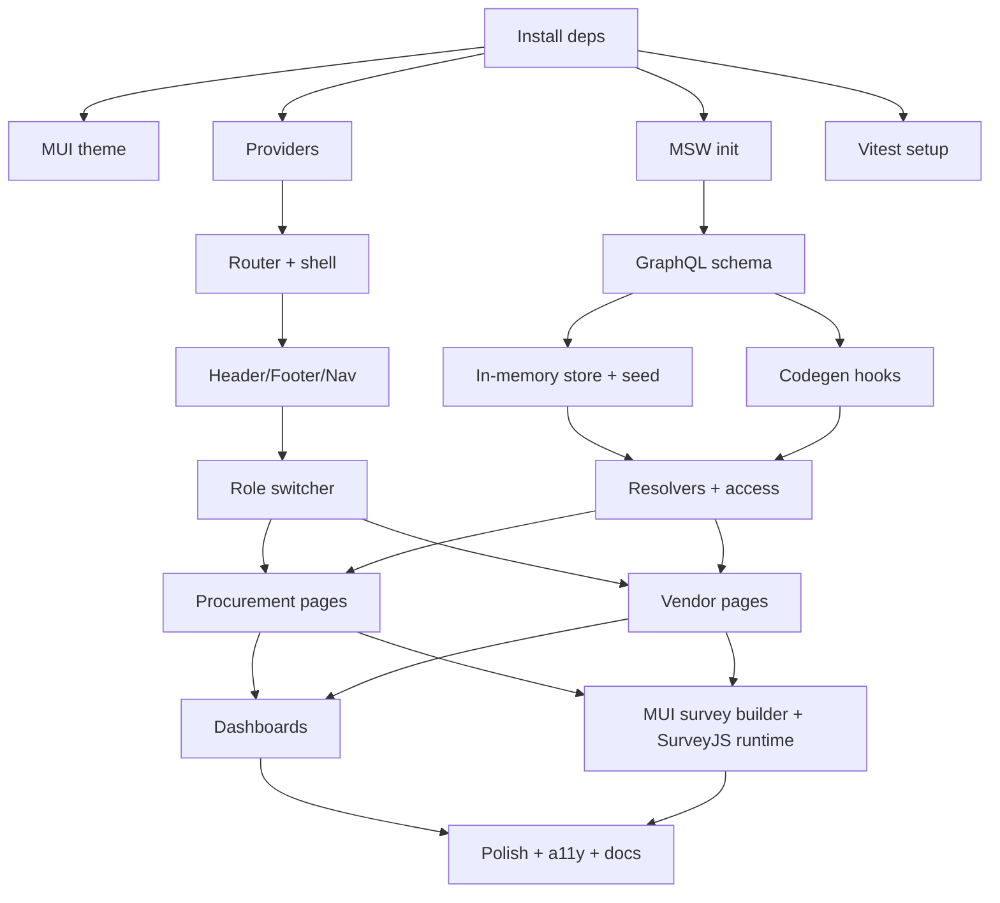
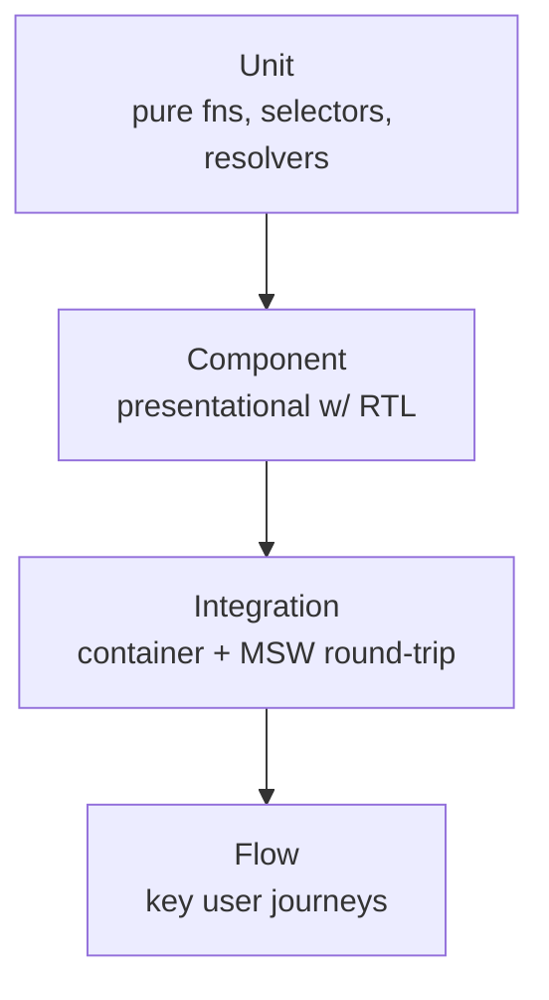

# 06 — Execution Plan

A phased plan to build the Vendor Proposal Management demo described in the
[Overview](./00-overview.md). Phases are ordered by dependency; each ends with a
verifiable outcome. The current repository is a fresh Vite + React + TypeScript
scaffold, so Phase 0 is foundational.

## 1. Phase map

Phases 3 and 4 can proceed in parallel once the shell (Phase 2) exists. Phases 5
and 6 depend on both feature sets.

## 2. Milestones & exit criteria

| Milestone | Phase | Exit criteria |
|---|---|---|
| M0 — Toolchain ready | 0 | Deps installed; MUI theme, Router, Query, Vitest, MSW wired; `npm run dev/build/test/lint` all pass. |
| M1 — Data layer live | 1 | GraphQL schema + codegen produce typed hooks; MSW resolves seeded queries; store resets on load. |
| M2 — Shell + roles | 2 | Header/footer/layout; role switcher changes nav; routes resolve; About page. |
| M3 — Procurement MVP | 3 | Projects list/detail (4 tabs), vendors list/detail, create/activate project. |
| M4 — Vendor MVP | 4 | Vendor projects, proposals, not-interested, sign-up & artifact completion. |
| M5 — Dashboards | 5 | Both dashboards render KPIs + charts from derived data. |
| M6 — Artifacts/forms | 6 | MUI survey builder (text/radio/checkbox/select) authoring, SurveyJS-runtime preview & completion; shared-artifact pre-fill. |
| M7 — Release polish | 7 | A11y pass, responsive, empty/error states, docs updated, tests green. |

## 3. Phase detail

### Phase 0 — Foundations
- Install dependencies: `@mui/material @emotion/react @emotion/styled @mui/x-charts`,
  `@tanstack/react-router @tanstack/react-query`, `survey-core survey-react-ui`
  (runtime only — **no** `survey-creator-react`), `msw`, and codegen dev deps.
- Configure MUI theme from the [color palette](./04-ui-ux.md#7-theming--color-palette).
- Set up providers (`QueryClientProvider`, `ThemeProvider`, `RoleProvider`).
- Set up TanStack Router with an empty route tree + shell.
- Set up Vitest + React Testing Library + jsdom; one smoke test.
- Initialize MSW (`msw init public/`) and worker bootstrap in `main.tsx`.

### Phase 1 — Data & Mock API
- Author `schema.graphql` and `operations/*.graphql` (see [Mock API](./05-mock-api.md)).
- Configure GraphQL codegen; generate typed hooks + the shared fetcher.
- Build the in-memory store, `resetStore`, and seed generators
  (see [Mock API §6](./05-mock-api.md)).
- Implement MSW handlers + domain resolvers with role-based access and simulated
  latency.
- Tests: resolver access rules, seed integrity, a round-trip query via MSW.

### Phase 2 — App shell & roles
- Shell: Header (logo, nav tabs, user menu), scrolling content, Footer.
- Role context + Role Switcher; role-dependent navigation tabs.
- Route tree per the [route map](./04-ui-ux.md#3-route-map); About page.
- "Reset demo data" action wired to `resetStore` + query cache clear.

### Phase 3 — Procurement features
- Projects: Active / In-development / Create tabs.
- Project detail tabs: Setup (edit + lock), Artifacts (soft delete + submissions
  sub-rows), Vendors (status + submission/additional sub-rows), Finalists (rank).
- Vendors list + vendor detail.
- Mutations: create/update/activate project, add/remove artifact, solicit, filter,
  approve, rank. Enforce the [proposal state machine](./03-workflows.md#6-proposal-state-machine).

### Phase 4 — Vendor features
- Projects (available, solicited pinned), sign up, mark not-interested.
- Proposals list → project detail (vendor view) with artifact completion.
- Not Interested list with reconsider.
- Shared Artifacts pre-fill.

### Phase 5 — Dashboards & charts
- Derived-metric selectors/resolvers (see [Data Model §5](./02-data-model.md)).
- Procurement dashboard: KPI strip + 6 cards (pie, lists, timeline, bars) via MUI
  X Charts.
- Vendor dashboard: scoped metrics + editable demographics.

### Phase 6 — Artifacts & Forms
- **MUI survey builder** for Lead artifact authoring: add/reorder/remove questions
  limited to `text`, `radiogroup`, `checkbox`, `dropdown`; edit title, required
  flag, and choices; emit SurveyJS-compatible schema saved to template (the
  SurveyJS Creator/Designer is **not** used).
- Read-only preview modal (procurement) via the SurveyJS runtime.
- Vendor completion via the SurveyJS runtime → submissions; shared-artifact
  responses copied into proposals.

### Phase 7 — Polish, accessibility, docs
- Loading/empty/error states across pages.
- Responsive breakpoints; keyboard nav; color-contrast checks.
- Update [README](../README.md) workflow section (link to [Workflows](./03-workflows.md)).
- Final test + lint pass.

## 4. Task dependency graph

## 5. Testing strategy

Confirmed: **Vitest + React Testing Library** (Vite-native, fast).

| Level | Scope | Examples |
|---|---|---|
| Unit | Derived metrics, date/format helpers, resolver access guards, state-machine transitions. | "sum estimated value of active projects"; "vendor cannot read others' proposals". |
| Component | Presentational components with props. | ProjectRow renders status chip; CreateProjectForm validation. |
| Integration | Container + generated hooks + MSW. | Projects page loads seeded data; create-project mutation invalidates cache. |
| Flow | End-to-end journeys against MSW. | Vendor signs up → completes artifact → appears in procurement Vendors tab. |

Guidelines:
- MSW is the single source of mock responses in tests and the app (shared handlers).
- Prioritize the proposal state machine and access rules — highest business risk.
- Keep presentational components pure to maximize fast component tests.
- Target: smoke coverage of every route + focused tests on state transitions and
  access control (not a coverage-percentage mandate).

## 6. Risks & mitigations

| Risk | Impact | Mitigation |
|---|---|---|
| Codegen tool mismatch ("React Native Codegen" vs GraphQL Code Generator) | Setup friction | Decision captured in [Mock API §9](./05-mock-api.md); abstraction keeps UI stable either way. |
| SurveyJS runtime bundle size / licensing | Build weight | Runtime only (`survey-core`/`survey-react-ui`); Creator/Designer excluded; lazy-load the builder/runtime routes; verify community licensing for demo use. |
| Custom MUI builder omits a needed question type | Authoring gaps | Scope is explicitly limited to text/radio/checkbox/select; schema stays SurveyJS-compatible so more types can be added later. |
| Chart data requires rich seed data | Empty dashboards | Seed spans statuses + a 60-day/6-month window ([Mock API §6](./05-mock-api.md)). |
| In-memory reset confuses users | Perceived data loss | "Reset demo data" button + About-page note that data is non-persistent. |
| Access rules duplicated UI + resolver | Divergence | Resolvers are the enforcement point; UI only hides/disables. |

## 7. Definition of done (demo)

- All routes in the [route map](./04-ui-ux.md#3-route-map) implemented and reachable
  for the appropriate role.
- Proposal lifecycle fully walkable across Lead/Officer/Vendor via the role switcher.
- Dashboards populated from seeded data; charts render without errors.
- MUI survey builder authoring + SurveyJS-runtime preview/completion functional.
- `npm run build`, `npm run lint`, and `npm run test` pass.
- Design docs and README workflow section reflect the delivered behavior.
